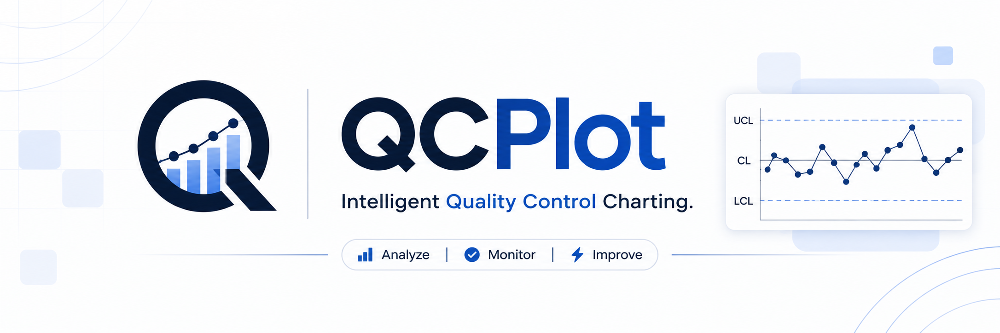
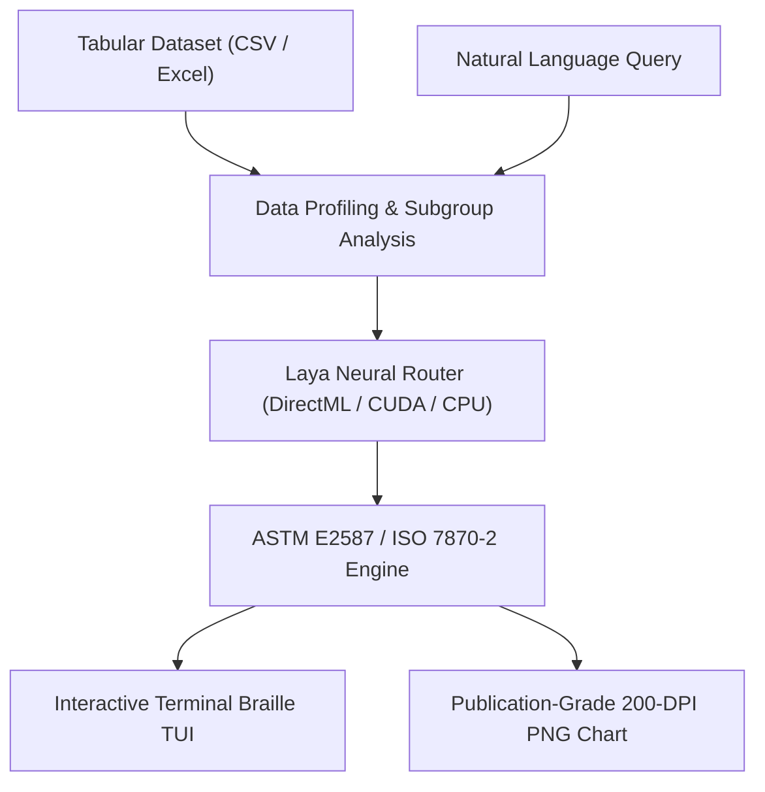
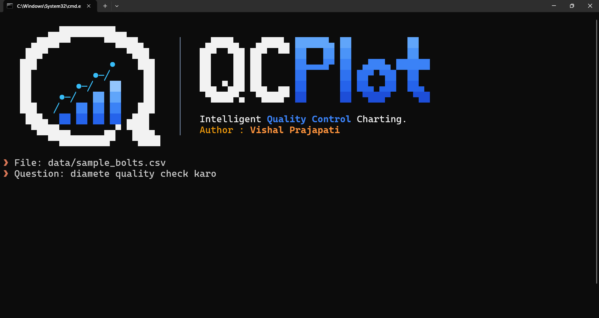
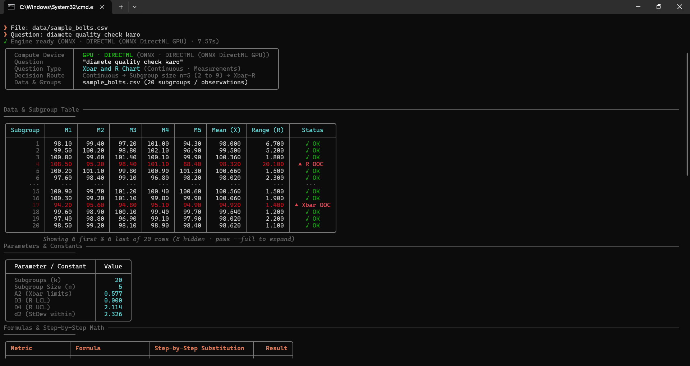
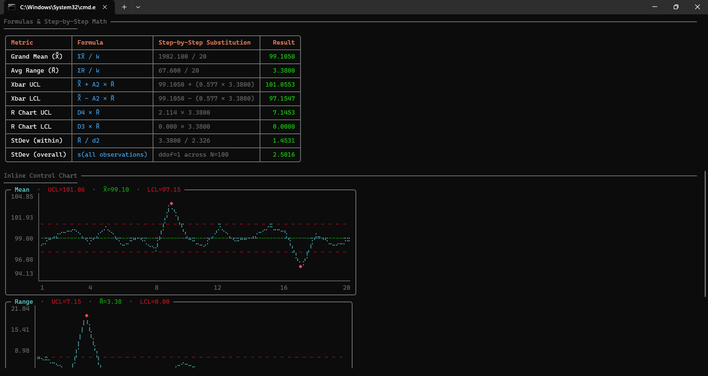
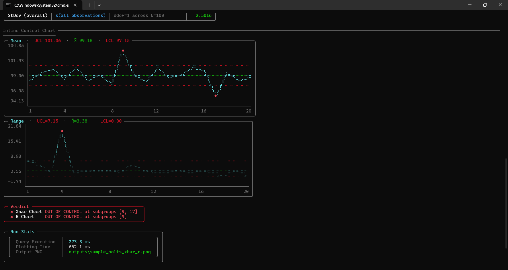
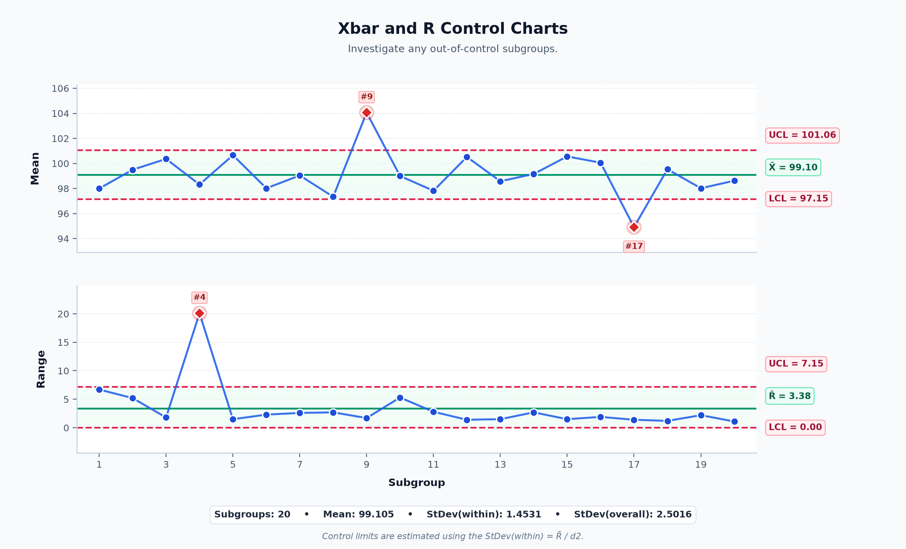

# QCPlot

<p align="center">
  
</p>

<p align="center">
  <a href="https://github.com/astral-sh/uv"></a>
  
  
  
  
  <a href="LICENSE.md"></a>
</p>

<p align="center">
  <strong>Autonomous Statistical Process Control (SPC) Engine & Intelligent Charting CLI</strong><br>
  <em>Author: Vishal Prajapati</em>
</p>

---

## Highlights

- ⚡ **Zero-Config SPC**: Pass tabular data (CSV/TSV/Excel) + query in natural language (English, Hinglish).
- 🧠 **Neural Chart Selection**: Fine-tuned Laya model infers subgroup size ($n$) and selects exact Shewhart charts.
- 📐 **ASTM E2587 / ISO 7870-2 Math**: Deterministic factor lookup ($A_2, D_3, D_4, c_4$) and exact 3-sigma limits.
- 🚀 **Hardware Accelerated**: ONNX Runtime with DirectML (AMD/Intel/NVIDIA), CUDA, Apple MPS, or CPU.
- 📊 **Dual Visual Outputs**: Native Unicode Braille terminal plots + publication-grade 200-DPI PNG charts.

---

## Architecture Pipeline



---

## Supported Control Charts

| Chart | Data Type | Subgroup ($n$) | Center Line & Limits | Typical Applications |
| :--- | :--- | :--- | :--- | :--- |
| **Xbar - R** | Continuous Variables | Small ($2 \le n \le 9$) | $\bar{\bar{X}} \pm A_2\bar{R}$ ; $\bar{R} \pm D_4\bar{R}$ | Machining part dimensions, fill weights |
| **Xbar - s** | Continuous Variables | Large ($n \ge 10$) | $\bar{\bar{X}} \pm A_3\bar{s}$ ; $\bar{s} \pm B_4\bar{s}$ | High-speed stamping, automated assays |
| **I - MR** | Continuous Individuals | Single ($n = 1$) | $\bar{X} \pm 2.66\bar{MR}$ ; $3.267\bar{MR}$ | Chemical yields, furnace temperatures |
| **p Chart** | Discrete Defectives | Variable ($n_i$) | $\bar{p} \pm 3\sqrt{\frac{\bar{p}(1-\bar{p})}{n_i}}$ | Defective unit ratios with unequal batches |
| **np Chart** | Discrete Defectives | Constant ($n$) | $n\bar{p} \pm 3\sqrt{n\bar{p}(1-\bar{p})}$ | Rejection counts per fixed lot (e.g. 100 PCBs) |
| **c Chart** | Discrete Defects | Constant sample unit | $\bar{c} \pm 3\sqrt{\bar{c}}$ | Flaws per textile roll, weld porosity |
| **u Chart** | Discrete Defects | Variable sample unit | $\bar{u} \pm 3\sqrt{\frac{\bar{u}}{n_i}}$ | Flaws per variable sheet metal area |

---

## Visual Showcase

### Terminal TUI Outputs

<p align="center">
  
  
</p>
<p align="center">
  
  
</p>

### Publication-Grade Chart

Saved automatically to `outputs/`:

<p align="center">
  
</p>

---

## Quickstart

### 1. Install & Setup (Cross-Platform)

Clone the repository and run the automated cross-platform installer (detects Windows, Linux, macOS, architecture, and GPU acceleration):

```bash
git clone https://github.com/codeXparadise/QCPlot.git
cd QCPlot

# Option A: Standalone Auto-Installer (Windows, Linux, macOS)
python install.py

# Option B: Using uv (fastest)
uv sync

# Option C: Standard pip
pip install -r requirements.txt
pip install -e .
```

### 2. Initialize

Configures directories, pulls default Laya model, and verifies GPU acceleration:

```bash
uv run qcplot --init
# or: python main.py --init
# or: ./scripts/qcplot.sh --init (Linux/macOS) / .\scripts\qcplot.bat --init (Windows)
```

### 3. Run Analysis

```bash
# Query sample bolt dataset in natural language
uv run qcplot -f data/sample_bolts.csv -q "Check bolt diameter stability"

# DirectML GPU acceleration (Windows AMD/Intel/NVIDIA)
uv run qcplot -f data/sample_bolts.csv -q "Bolt diameter stability check karo" --device directml

# Discrete attribute c-chart on CPU
uv run qcplot -f data/c_defects.csv -q "Inspect flaws count per batch" --device cpu

# Interactive session (keeps model resident in GPU memory)
uv run qcplot --interactive
```

*(Note: You can also run `python main.py [OPTIONS]` or `.\scripts\qcplot.bat [OPTIONS]` on Windows).*

---

## Model & Device CLI

```bash
# System hardware diagnostics (DirectML / CUDA / MPS / CPU)
uv run qcplot --device-info

# Check installed models and cache sizes
uv run qcplot --models

# Pull additional model checkpoint
uv run qcplot --pull english

# Export model to ONNX
uv run qcplot --export-onnx multilingual

# Change persistent default model
uv run qcplot --set-default multilingual

# Remove cached model or purge all
uv run qcplot --remove english
```

---

## Options Reference

| Option | Description |
| :--- | :--- |
| `-f, --file PATH` | Tabular dataset path (CSV, TSV, XLSX, XLS) |
| `-q, --question TEXT` | Natural language SPC question (English, Hinglish, etc.) |
| `-o, --output PATH` | High-res PNG output location (default: `outputs/`) |
| `--interactive` | Interactive shell keeping model in GPU memory |
| `--model NAME` | Model variant: `multilingual`, `english`, `typed-decisions` |
| `--device MODE` | Compute target: `auto`, `directml`, `cuda`, `mps`, `cpu` |
| `--backend MODE` | Inference engine: `auto`, `onnx`, `torch` |
| `--device-info` | Display active hardware devices and providers |
| `--models` | List installed models and disk usage |
| `--pull NAME` | Download and cache a model checkpoint |
| `--export-onnx NAME` | Export a model checkpoint to ONNX format |
| `--set-default NAME` | Set default model variant |
| `-r, --remove NAME` | Delete a model checkpoint or `all` |
| `--init` | First-time environment setup wizard |
| `--full` | Print all subgroup rows without truncation |
| `--popup` | Display interactive Matplotlib window |
| `-h, --help` | Show command help |

---

## Repository Structure

```text
QCPlot/
├── assets/             # Brand logos, flowchart assets & screenshot previews
├── data/               # Industrial benchmark datasets (bolts, defects, temps)
│   └── .gitkeep
├── model/              # Model weights, ONNX exports & cache
│   ├── .gitkeep
│   └── qcplot_config.json
├── outputs/            # Generated 200-DPI PNG control charts
│   └── .gitkeep
├── scripts/            # Standalone platform launchers (qcplot.bat, qcplot.ps1)
├── src/                # PEP 517 / PEP 621 package source tree
│   └── qcplot/
│       ├── __init__.py # Package exports (__version__, main)
│       └── cli.py      # Core SPC engine, neural routing & ASTM math
├── main.py             # Root execution forwarder
├── requirements.txt    # Categorized pip dependencies
├── pyproject.toml      # Build metadata & dependency definitions
├── uv.lock             # Deterministic dependency lockfile
├── .gitignore          # Multi-tier git exclusion rules
├── LICENSE.md          # MIT License
├── CODE_OF_CONDUCT.md  # Contributor Code of Conduct
├── CONTRIBUTING.md     # Development & contribution guidelines
└── README.md           # Concise, visual project documentation
```

---

## License & Community

- Built with care by **Vishal Prajapati**.
- **License**: [MIT License](LICENSE.md).
- **Contributing**: [Contribution Guidelines](CONTRIBUTING.md).
- **Community Standards**: [Code of Conduct](CODE_OF_CONDUCT.md).
